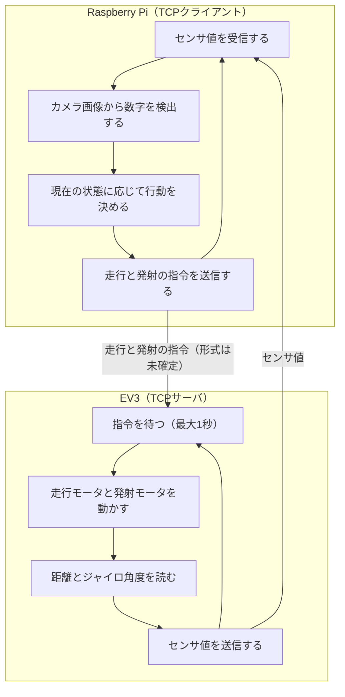
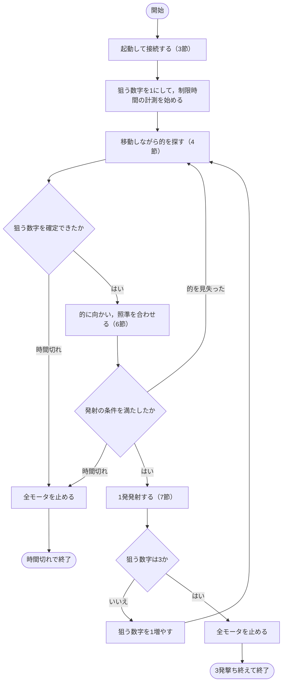
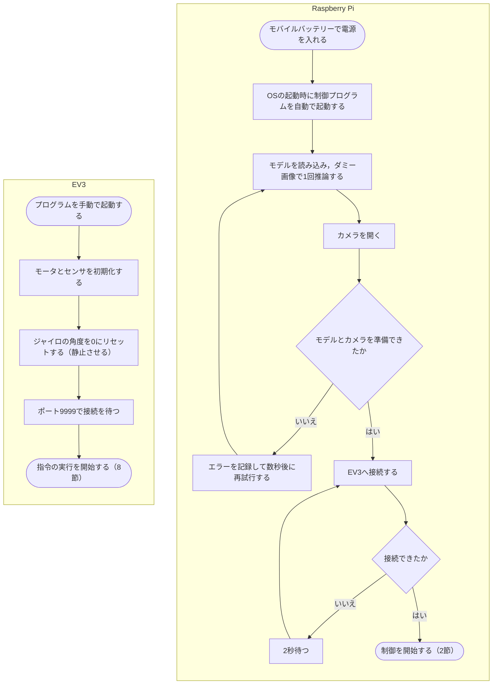
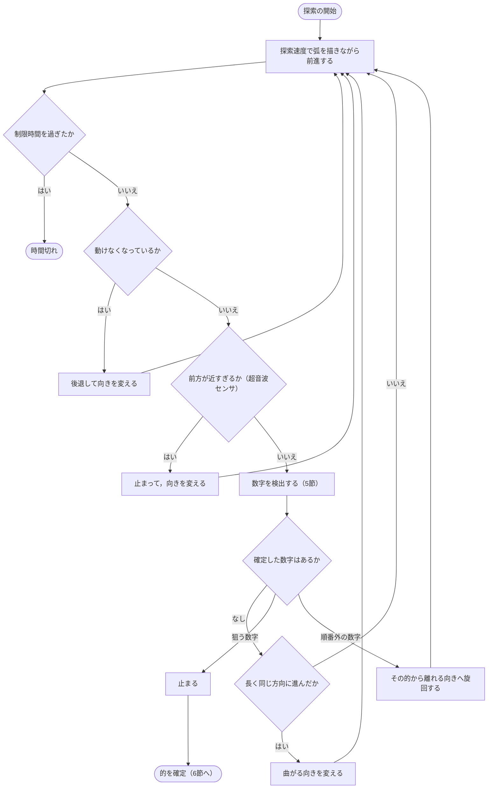
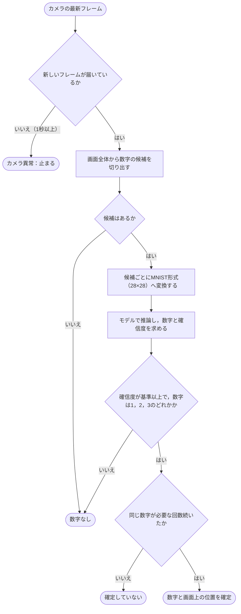
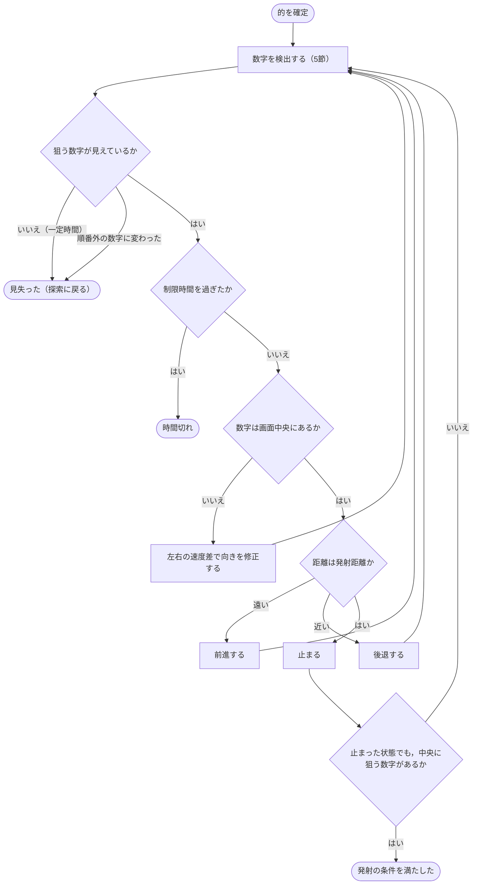
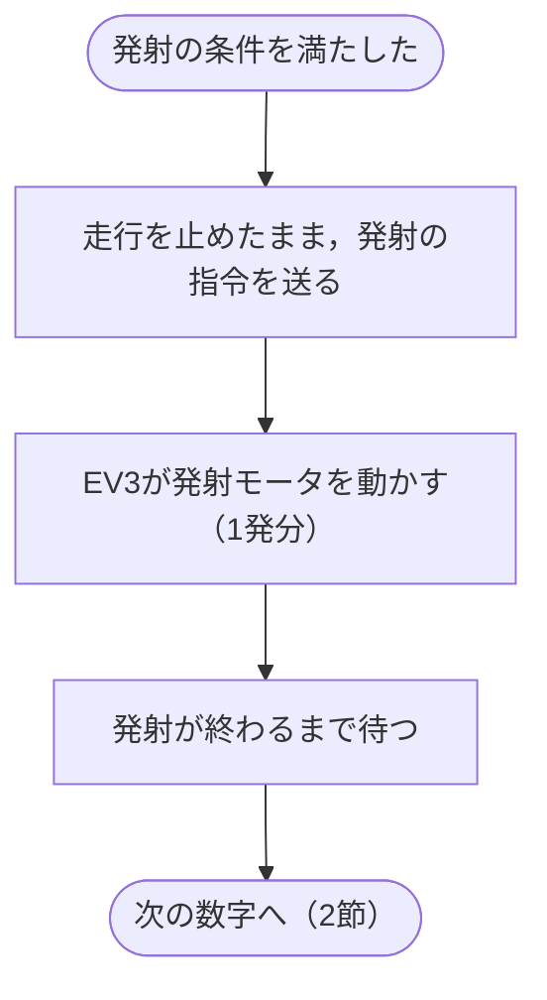
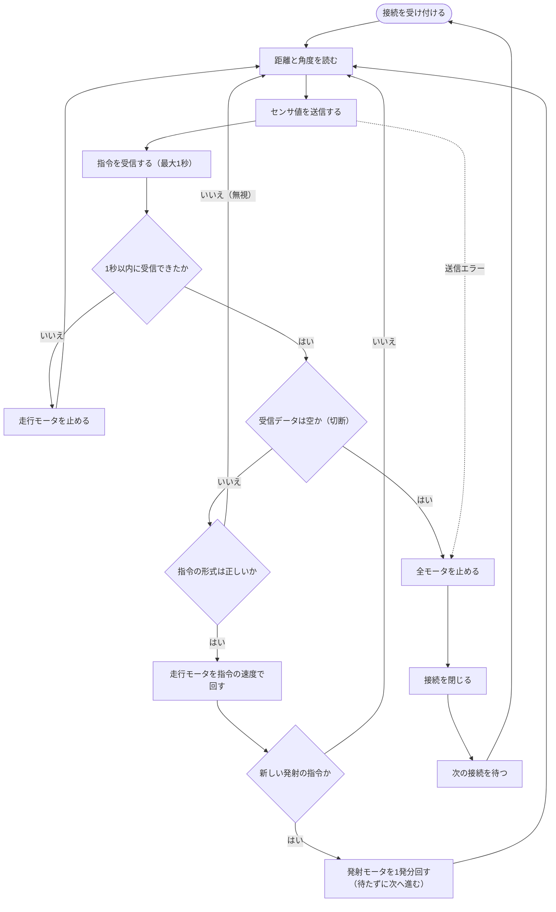

# 最終システムのフローチャート（初版）

完成時に目指すシステムの処理の流れを示す．**これは計画であり，大部分は未実装である．** 現在の実装は `flowchart.md` を参照する．

図の記号は，楕円が開始と終了，四角が処理，ひし形が条件分岐，点線が例外や中断による移動を表す．

## 設計の前提

### 決定事項

| 項目 | 内容 |
|---|---|
| 順番 | 1 → 2 → 3 の順に倒す．順番を間違えると失敗になる． |
| 倒し方 | 輪ゴム銃の弾を発射して，離れた位置から的に当てる． |
| 探索 | 移動しながら的を探す． |
| 距離の測定 | 超音波センサで的までの距離を読む． |
| 障害物 | ない．床にあるのは的だけとする． |
| モータ | 3個（走行用2個，発射用1個）． |
| 弾 | 3発．的1枚につき1発だけ撃つ． |
| 倒れたかの判定 | 行わない．発射したら次の数字へ進む．外すと弾が足りず全部は倒せないので，判定しても結果は変わらない． |
| 起動 | Raspberry Piはモバイルバッテリーで動かす．EV3のプログラムを手動で起動すると走り出す． |

### 暫定案（変更の可能性あり）

| 項目 | 内容 |
|---|---|
| 的の枚数 | 各数字1枚とする．最初の位置から見えない的もあるとする． |
| 床の境界 | 落下のおそれはないとする．範囲外の扱いは未定義とする． |
| 開始と判定 | 開始位置は任意，的が倒れたかの判定は目視とする．再スタートはできないものとして作る． |
| カメラ | 固定とする（首振りなし）． |
| 検出の範囲 | 画面全体から数字の候補を切り出す． |
| 照準 | 数字が画面中央に来るように，左右の速度を調整する． |
| 動けない場合 | 後退して向きを変える． |
| 通信切断 | EV3は切断後に接続待ちへ戻る．的の進み具合はRaspberry Pi側で保持する． |
| 終了 | 3に向けて撃ったら停止する．見つからなければ制限時間まで探す． |

### 未確定のパラメータ

| 名前 | 内容 | 状況 |
|---|---|---|
| `FIRE_DISTANCE_MM` | 発射する距離 | 保留中．数字を読める距離と銃の射程から決める． |
| `DISTANCE_TOLERANCE_MM` | 発射距離の許容幅 | 実測して決める． |
| `AIM_TOLERANCE_PX` | 発射してよい中央からのずれ | 実測して決める． |
| `FIRE_WAIT_S` | 発射後，次の動作を始めるまで待つ時間 | 実測して決める． |
| `TIME_LIMIT_S` | 制限時間 | 課題で未定．変更できるようにする． |

## 1. システム全体

判断はすべてRaspberry Piが行い，EV3は指令の実行とセンサ値の送信だけを行う．

## 2. 全体の流れ

狙う数字を1から順に進める．的が確定するまでは発射しない．

## 3. 起動と接続

EV3のプログラムを手動で起動すると，接続が完了して走り出す．Raspberry PiはPCの操作なしで起動し，接続できるまで再試行する．

## 4. 移動しながらの探索

ゆるやかに曲がりながら前進し，走行中も数字を検出し続ける．順番外の的は倒すと失敗になるので，近づかないように避ける．

## 5. 数字の検出

誤った的を撃つと失敗になるので，同じ数字が続けて高い確信度で検出されたときだけ確定する．

## 6. 接近と照準

数字を画面中央に合わせ，超音波センサの距離が発射距離になるまで進む．

## 7. 発射

的1枚につき1発だけ撃つ．倒れたかどうかは判定せず，次の数字へ進む．

## 8. EV3側のサーバ

判断は行わない．切断されても終了せず，接続待ちに戻る．

## 実装と検証の課題

| 項目 | 内容 |
|---|---|
| 通信形式の変更 | 発射の指令を追加する必要がある．同じ指令で2回撃たないように，発射番号を持たせる案がある（`left_speed,right_speed,shot_id\n`）．形式は未確定． |
| EV3のモータ構成 | 現在のコードは走行4個なので，走行2個と発射1個に変更する． |
| 命中精度 | 弾は的と同じ3発なので，全部倒すには1発も外せない．発射距離は，数字を読める距離だけでなく，確実に当たる距離から決める必要がある．要検証． |
| 外したときの動作 | ロボットは外したことを認識できず，次の数字へ進む．例えば1を外して2を倒すと，順番違いになる． |
| 発射の確実性 | モータを1発分回したときに，弾が確実に1発だけ出るか要検証． |
| 誤射の防止 | 狙う的の後ろに順番外の的があると，外れた弾が当たるおそれがある． |
| 走行中の接触 | 走行中に見つけていない順番外の的に接触すると，失敗になるおそれがある．探索速度は要検証． |
| 倒れた的の扱い | 倒れた的の数字が読めても，順番外の的として避けるだけで，撃たない． |
| 距離の測定 | 超音波センサで板までの距離を発射距離まで読めるか要検証． |
| 数字の認識 | MNISTのモデルで印刷された数字を発射距離から読めるか要検証．再学習の要否もこの結果で決める． |
