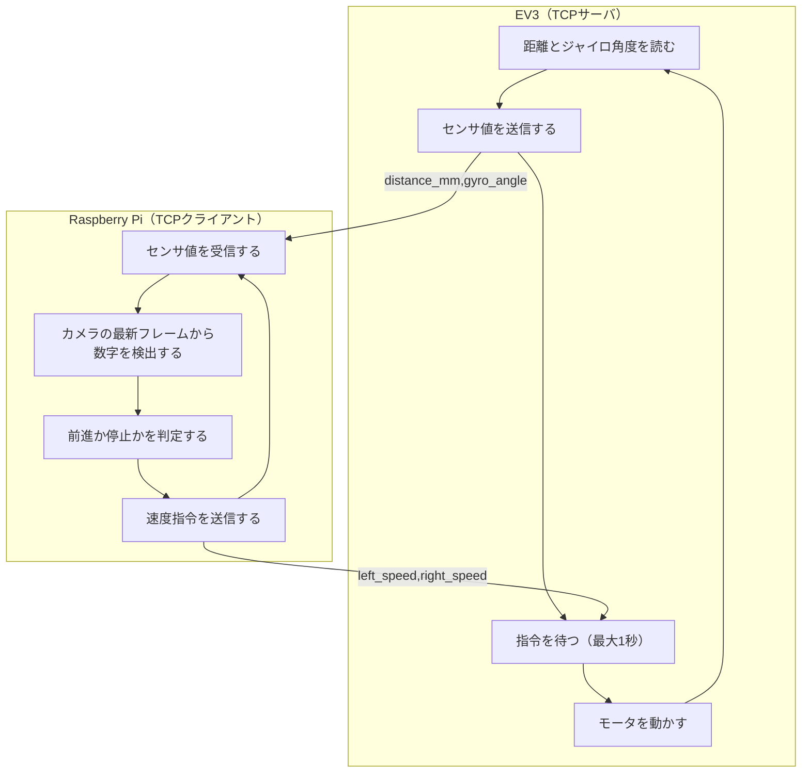
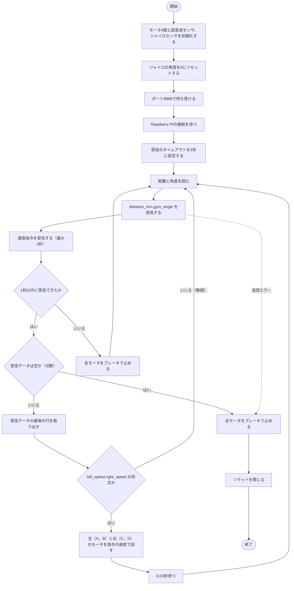
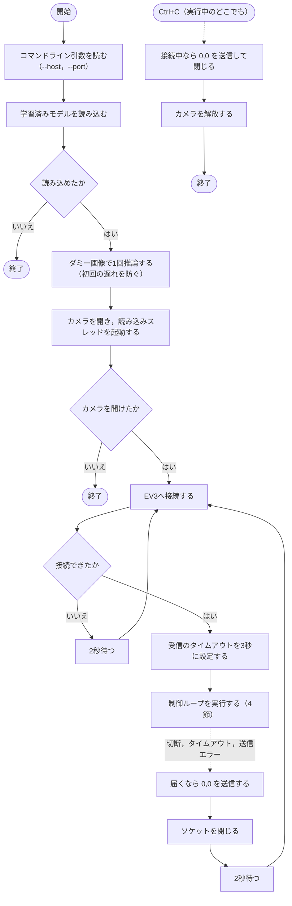
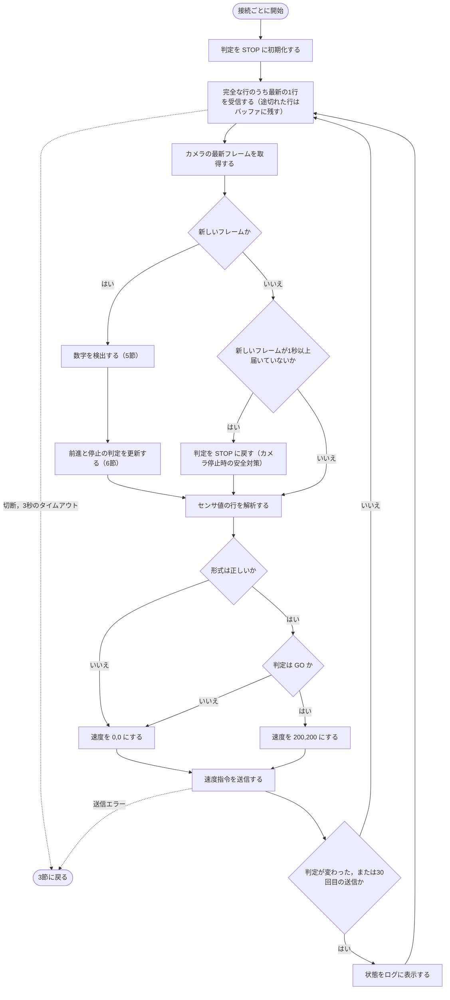
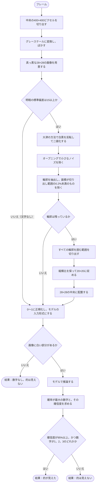
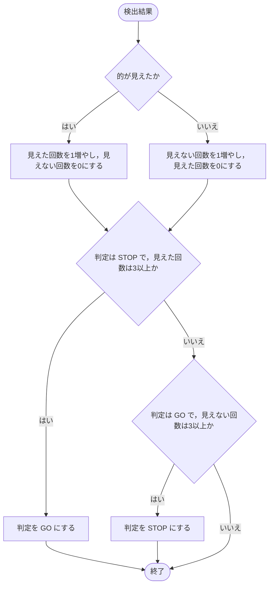
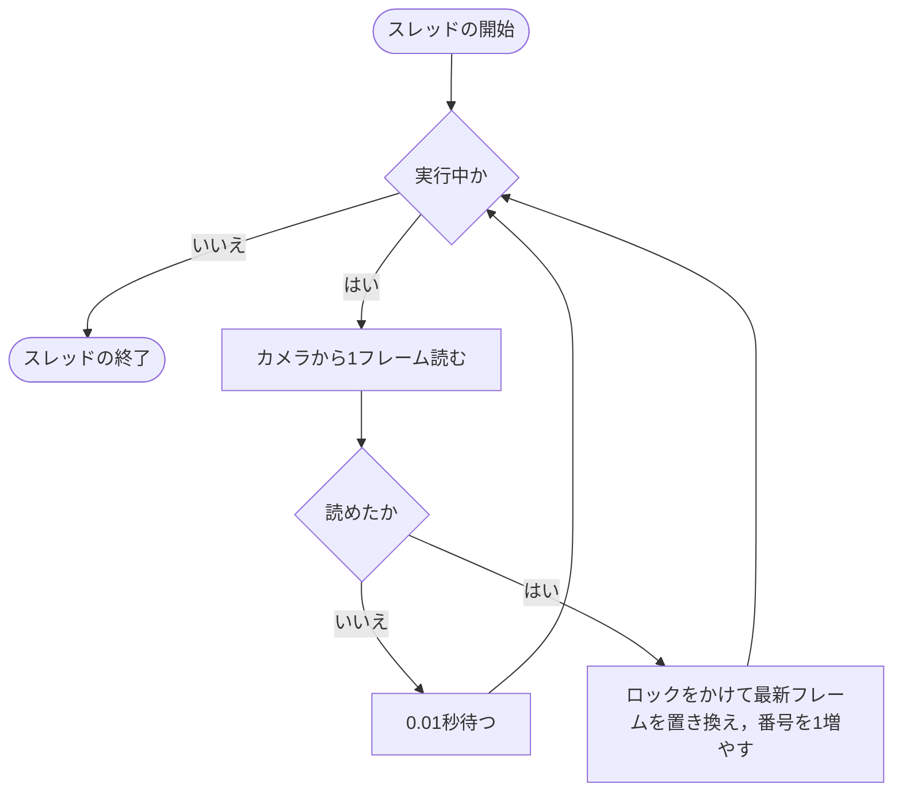
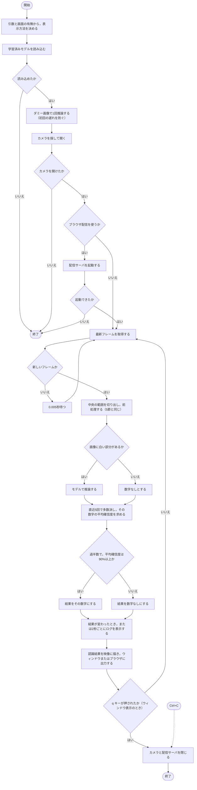

# プログラムのフローチャート

現在のプログラムの処理の流れを示す．

- **現在の動作:** 数字（1，2，3）のどれかが見えている間だけ前進し，見えなくなったら止まる．
- **未実装:** 1 → 2 → 3 の順番の管理，的の探索，旋回．
- **図の記号:** 楕円は開始と終了，四角は処理，ひし形は条件分岐，点線は例外による移動を表す．

| 節 | 対象 | ファイル |
|---|---|---|
| 1 | システム全体 | `robot_controller.py`，`motor_sensor_server.py` |
| 2 | EV3側のサーバ | `ev3_server/motor_sensor_server.py` |
| 3 | Pi側の起動と再接続 | `raspi_client/robot_controller.py` の `main` |
| 4 | Pi側の制御ループ | `raspi_client/robot_controller.py` の `run_session` |
| 5 | 数字の検出 | `robot_controller.py` の `detect_digit`，`digit_recognizer.py` |
| 6 | 前進と停止の判定 | `raspi_client/robot_controller.py` の `GoStopDecider` |
| 7 | カメラの読み込み | `raspi_client/camera.py` の `LatestFrameReader` |
| 8 | 認識の確認ツール | `raspi_client/recognition_viewer.py` の `main` |

## 1. システム全体

EV3がセンサ値を1行送るたびに，Raspberry Piが速度指令を1行返す．

## 2. EV3側のサーバ

判断は行わず，センサ値の送信と受け取った指令の実行だけを行う．接続は1回だけ受け付け，切断されるとプログラムは終了する．

## 3. Raspberry Pi側の起動と再接続

EV3との接続が切れても，再接続を繰り返す．

## 4. Raspberry Pi側の制御ループ

センサ値を受信するたびに1回実行する．新しいフレームがないときは，推論も回数の加算も行わない．

## 5. 数字の検出

画像をMNISTと同じ形式（黒背景に白文字，28×28）にそろえてから推論する．

処理中にエラーが起きた場合も，「数字なし，的は見えない」として扱う．

## 6. 前進と停止の判定

推論のちらつきで動作が切り替わらないように，同じ結果が3回続いたときだけ判定を変える．

## 7. カメラの読み込み

別スレッドで読み込みを続けて，常に最新の1フレームだけを保持する．推論が撮影より遅くても，古い映像を処理せずに済む．

## 8. 認識の確認ツール

EV3を使わずに，カメラと数字認識だけを確認する．実走では使わない．

