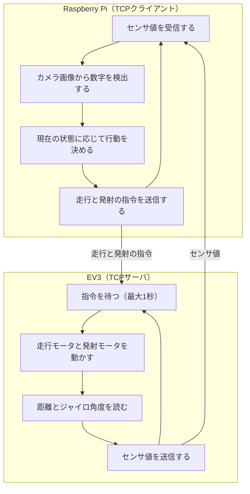
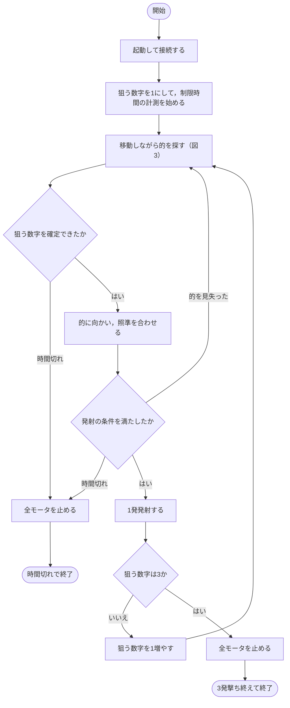
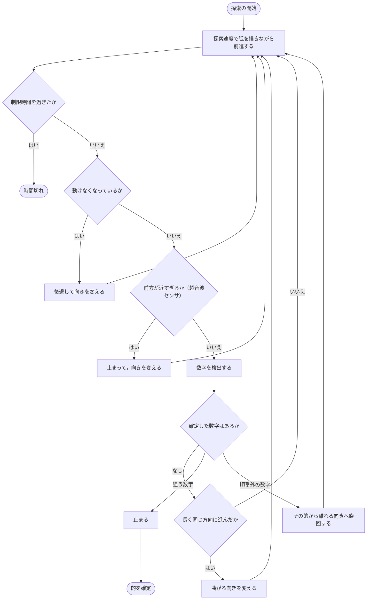

# 開発計画書用フローチャート

完成時に目指すシステムの処理の流れを示す．これは計画であり，大部分は未実装である．

図の記号は，楕円が開始と終了，四角が処理，ひし形が条件分岐を表す．

## 図1. システム全体

判断はすべてRaspberry Piが行い，EV3は指令の実行とセンサ値の送信だけを行う．

## 図2. 全体の流れ

狙う数字を1から順に進める．的が確定するまでは発射しない．的1枚につき1発だけ撃ち，倒れたかどうかは判定しない．

## 図3. 移動しながらの探索

ゆるやかに曲がりながら前進し，走行中も数字を検出し続ける．順番外の的は倒すと失敗になるので，近づかないように避ける．

